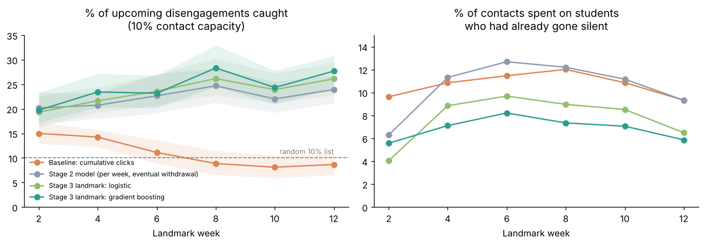
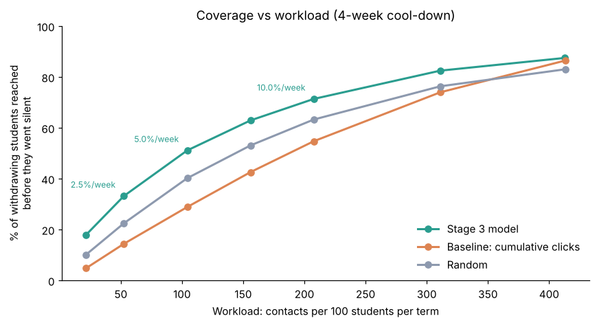
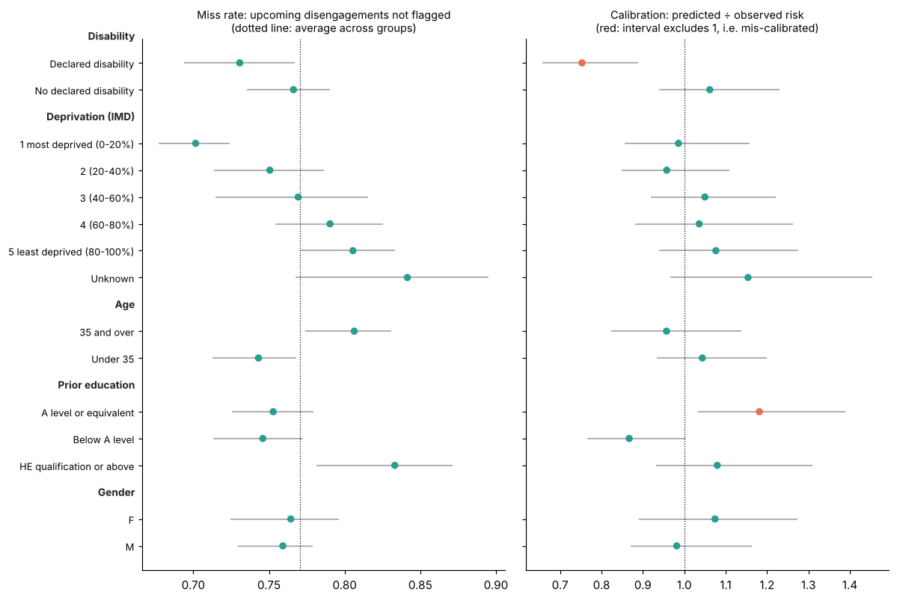
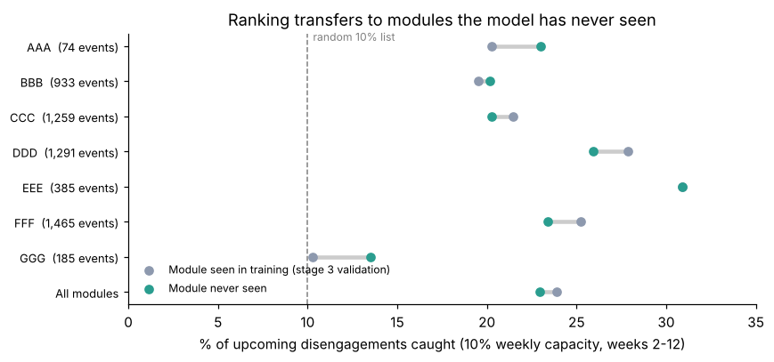

# Engagement Early-Warning

**Which students need support, and how many weeks before they withdraw can we tell?**

An independent research prototype that turns daily virtual learning environment (VLE) activity into
calibrated, explainable, week-by-week risk of withdrawal, evaluated the way a student-support team
would use it: *with limited tutor time, how many future withdrawals do we catch, and how early?*

Built on the open [Open University Learning Analytics Dataset (OULAD)](https://research.stem.open.ac.uk/ouanalyse/dataset/)
(32,593 enrolments, 22 module presentations, 10.6M daily click records). Not affiliated with any company or product.

> Status: stages 1–6 complete. Stage 7 (tutor dashboard) in progress.

## Findings so far (stage 1)


- **A quarter of withdrawals (2,676 of 10,156) happen before the module starts.** No in-course data can
  predict these, so they are excluded from model metrics and reported separately.
- **A descriptive engagement score is a weak withdrawal predictor.** Contacting the 10% least-engaged
  students in each cohort each week, 16–30% of contacts reach a future withdrawal, against a 13–20% base
  rate (AUC about 0.60). That catches 13–15% of withdrawals (95% interval 11–17%, bootstrapped over cohorts).
- **The reason is that failing students disengage too.** For "will fail *or* withdraw", the same scores
  are much better: 60–85% of contacts are well aimed (base rate 40–45%).
- **Apparent warning time is mostly administrative delay.** Flags come about 9 weeks before official
  withdrawal, but only 0–3 weeks before the student's last VLE activity. Later in the term, up to half of
  the "caught" students had already gone silent. Later stages are judged on warning *before last activity*.

Full analysis: [`notebooks/01_eda_and_baseline.ipynb`](notebooks/01_eda_and_baseline.ipynb). Every
decision is in [`docs/build_log.md`](docs/build_log.md).

## Stage 2: research-led features


- **Reliably better than the baseline from week 4.** Precision for future withdrawals rises 6–11 percentage
  points (paired bootstrap intervals exclude 0); AUC rises from 0.60 to 0.66–0.70. Cross-validation keeps whole
  module presentations out of training.
- **Flags now come before students go silent:** a median of 1.6–2.6 weeks before their last VLE activity,
  where the baseline flagged *after* it from week 8.
- **Assessment behaviour carries most of the signal** (missed and late submissions, released scores).
- **Negative result:** "drop from the student's own baseline" features added nothing measurable here.

Full analysis: [`notebooks/02_features.ipynb`](notebooks/02_features.ipynb).

## Stage 3: predicting disengagement *before* it happens



- **New target: disengagement onset.** Each week, which students will go silent for good in the next 4 weeks?
  This avoids rewarding flags on students who have already left (official withdrawal lags last activity).
- **One landmark model across weeks 1–24** (617k student-weeks), validated with whole presentations held out.
- **Catches 23–28% of upcoming disengagements at 10% capacity** (random: 10%), a median of 1.3–2.3 weeks ahead.
  The engagement baseline falls to about random on this target.
- **Calibrated probabilities**: predicted and observed risk agree within about 1 point in every decile, which is
  what a tutor-facing risk score needs. The ranking gain over stage 2 is small (+1 pp, significant at weeks 8 and 12).

Full analysis: [`notebooks/03_landmark_onset.ipynb`](notebooks/03_landmark_onset.ipynb).

## Stage 4: a term of outreach



- **Simulates a support team over weeks 1–24:** each week it contacts its top-risk students, with a cool-down before
  re-contacting anyone. The measure is the share of withdrawing students reached *before they went silent*.
- **At realistic capacity the model reaches about 11 more students in every 100** than a random list (33% vs 22% at
  2.5% of each cohort per week; 51% vs 40% at 5%; paired intervals of roughly 8–14 points).
- **The engagement baseline does worse than random** over a term, because it keeps returning to students who have
  already gone. It is better suited to academic support (70–85% of its contacts fail or withdraw).
- **The cool-down matters as much as the model:** with no cool-down, 5% weekly capacity reaches only 30%.

Full analysis: [`notebooks/04_outreach_policy.ipynb`](notebooks/04_outreach_policy.ipynb).

## Stage 5: fairness audit



- **Disability: the model understates risk by about a quarter** (calibration 0.75 vs 1.06; the gap's interval
  excludes 0). Disabled students disengage more often (5.2% vs 3.3%), so they are still flagged and reached
  slightly more, but the probability a tutor sees is too low.
- **Older students (35+) and students with a degree are missed 6–8 points more often.** Gender shows no gaps; the
  most deprived quintile is missed *less*.
- **Recalibrating by disability fixes the calibration at no cost to overall performance** and raises term coverage
  of disabled withdrawers from 57% to 74%. It uses a protected characteristic, so it is reported as an
  institutional choice, not a default.

Full analysis: [`notebooks/05_fairness.ipynb`](notebooks/05_fairness.ipynb).

## Stage 6: would it work at a new university?



- **The weekly contact list transfers to modules the model has never seen.** It catches 22.9% of upcoming
  disengagements, against 23.9% when the module was seen in training (−0.9 points); trained on 2013 and tested on
  2014, the drop is similar. A module's own history adds little to the ranking.
- **Probabilities do not transfer per module:** predicted risk is off by a factor of 0.7–2.4 depending on the module.
- **One completed local run fixes most of this** when the correction is shrunk for small samples (mean error
  0.44 → 0.22; worst module off by 1.5× instead of 2.4×).
- **For a new client:** use the ranked list from day one, and treat probabilities as provisional until each module
  has completed one run.

Full analysis: [`notebooks/06_transfer.ipynb`](notebooks/06_transfer.ipynb).

## Approach

| Stage | Question |
| --- | --- |
| 1. Engagement-band baseline ✅ | How far does a simple "engagement level" (none → very high, relative to the cohort) get you? |
| 2. Research-led features ✅ | Volume, regularity, recency, change from the student's *own* baseline, plus assessment behaviour (late or missed submissions) |
| 3. Week-by-week risk model ✅ | A discrete-time survival model: risk of withdrawing in each week, using only data available up to that week (no leakage) |
| 4. Capacity-aware evaluation ✅ | With 10% tutor capacity per week: precision, recall (with bootstrap intervals), and warning time before last activity |
| 5. Fairness and inclusion audit ✅ | Demographics are never model inputs; calibration and miss rates are audited by disability, deprivation (IMD) band and age |
| 6. Generalising to new modules ✅ | Train on some modules, test on unseen ones: a proxy for rolling out to a new institution |
| 7. Tutor dashboard | A weekly list of flagged students with a plain-English reason for each flag |

## Getting the data

1. Download `anonymisedData.zip` from the [OU Analyse dataset page](https://research.stem.open.ac.uk/ouanalyse/dataset/),
   or use the Parquet copies in the [data-edu/oulad](https://github.com/data-edu/oulad) mirror
   (`inst/extdata/`). Both have identical row counts and outcome splits.
2. Put the seven tables (`.csv` or `.parquet`) in `data/raw/`.

## Running it

macOS / Linux (with `make`):

```bash
make install
make data      # builds data/processed/*.parquet
make test
```

Windows (PowerShell), or anywhere without `make`:

```powershell
python -m venv .venv
.venv\Scripts\Activate.ps1
pip install -e ".[dev]"
python -m eew.data
pytest -q
```

Then open the notebooks in `notebooks/`.

## Project layout

```
src/eew/        package code: data loading, population rules, baselines, evaluation
notebooks/      numbered analysis notebooks
dashboards/     Streamlit tutor dashboard (stage 7)
docs/           build log and figures
results/        metrics (CSV)
tests/          unit tests
```

## Data licence and citation

OULAD is released under CC BY 4.0. Kuzilek, J., Hlosta, M. & Zdrahal, Z. (2017). Open University
Learning Analytics dataset. *Scientific Data* 4, 170171. https://doi.org/10.1038/sdata.2017.171
