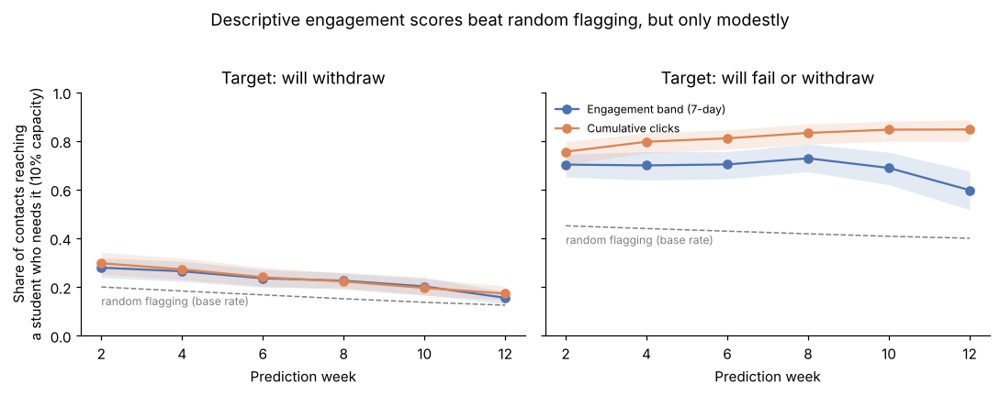
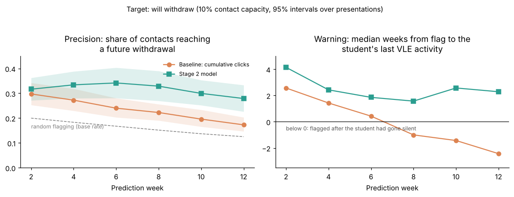

# Engagement Early-Warning

**Which students need support, and how many weeks before they withdraw can we tell?**

An independent research prototype that turns daily virtual learning environment (VLE) activity into
calibrated, explainable, week-by-week risk of withdrawal, evaluated the way a student-support team
would use it: *with limited tutor time, how many future withdrawals do we catch, and how early?*

Built on the open [Open University Learning Analytics Dataset (OULAD)](https://research.stem.open.ac.uk/ouanalyse/dataset/)
(32,593 enrolments, 22 module presentations, 10.6M daily click records). Not affiliated with any company or product.

> Status: stages 1–2 complete. Stages 3–7 in progress.

## Findings so far (stage 1)



- **A quarter of withdrawals (2,676 of 10,156) happen before the module starts.** No in-course data can
  predict these, so they are excluded from model metrics and reported separately.
- **A descriptive engagement score is a weak withdrawal predictor.** Contacting the 10% least-engaged
  students in each cohort each week, 16–30% of contacts reach a future withdrawal, against a 13–20% base
  rate (AUC about 0.60). That catches 13–15% of withdrawals (95% interval 11–17%, bootstrapped over cohorts).
- **The reason is that failing students disengage too.** For "will fail *or* withdraw", the same scores
  are much better: 60–85% of contacts are well aimed (base rate 40–45%).
- **Apparent warning time is mostly administrative delay.** Flags come about 9 weeks before official
  withdrawal, but only 0–3 weeks before the student's last VLE activity. Later in the term, up to half of
  the "caught" students had already gone silent. Later stages are judged on warning *before last activity*.

Full analysis: [`notebooks/01_eda_and_baseline.ipynb`](notebooks/01_eda_and_baseline.ipynb). Every
decision is in [`docs/build_log.md`](docs/build_log.md).

## Stage 2: research-led features



- **Reliably better than the baseline from week 4.** Precision for future withdrawals rises 6–11 percentage
  points (paired bootstrap intervals exclude 0); AUC rises from 0.60 to 0.66–0.70. Cross-validation keeps whole
  module presentations out of training.
- **Flags now come before students go silent:** a median of 1.6–2.6 weeks before their last VLE activity,
  where the baseline flagged *after* it from week 8.
- **Assessment behaviour carries most of the signal** (missed and late submissions, released scores).
- **Negative result:** "drop from the student's own baseline" features added nothing measurable here.

Full analysis: [`notebooks/02_features.ipynb`](notebooks/02_features.ipynb).

## Approach

| Stage | Question |
| --- | --- |
| 1. Engagement-band baseline ✅ | How far does a simple "engagement level" (none → very high, relative to the cohort) get you? |
| 2. Research-led features ✅ | Volume, regularity, recency, change from the student's *own* baseline, plus assessment behaviour (late or missed submissions) |
| 3. Week-by-week risk model | A discrete-time survival model: risk of withdrawing in each week, using only data available up to that week (no leakage) |
| 4. Capacity-aware evaluation | With 10% tutor capacity per week: precision, recall (with bootstrap intervals), and warning time before last activity |
| 5. Fairness and inclusion audit | Demographics are never model inputs; calibration and miss rates are audited by disability, deprivation (IMD) band and age |
| 6. Generalising to new modules | Train on some modules, test on unseen ones: a proxy for rolling out to a new institution |
| 7. Tutor dashboard | A weekly list of flagged students with a plain-English reason for each flag |

## Getting the data

1. Download `anonymisedData.zip` from the [OU Analyse dataset page](https://research.stem.open.ac.uk/ouanalyse/dataset/),
   or use the Parquet copies in the [data-edu/oulad](https://github.com/data-edu/oulad) mirror
   (`inst/extdata/`). Both have identical row counts and outcome splits.
2. Put the seven tables (`.csv` or `.parquet`) in `data/raw/`.

## Running it

macOS / Linux (with `make`):

```bash
make install
make data      # builds data/processed/*.parquet
make test
```

Windows (PowerShell), or anywhere without `make`:

```powershell
python -m venv .venv
.venv\Scripts\Activate.ps1
pip install -e ".[dev]"
python -m eew.data
pytest -q
```

Then open the notebooks in `notebooks/`.

## Project layout

```
src/eew/        package code: data loading, population rules, baselines, evaluation
notebooks/      numbered analysis notebooks
dashboards/     Streamlit tutor dashboard (stage 7)
docs/           build log and figures
results/        metrics (CSV)
tests/          unit tests
```

## Data licence and citation

OULAD is released under CC BY 4.0. Kuzilek, J., Hlosta, M. & Zdrahal, Z. (2017). Open University
Learning Analytics dataset. *Scientific Data* 4, 170171. https://doi.org/10.1038/sdata.2017.171
