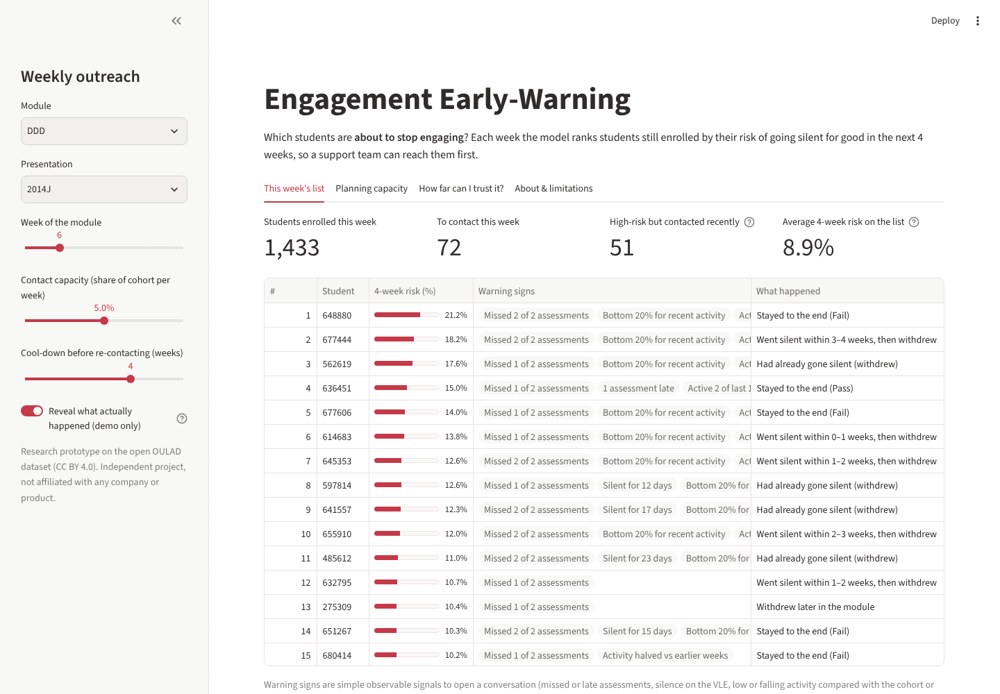

# Engagement Early-Warning

**Each week, which students are about to stop engaging, and can a support team reach them first?**

An independent research prototype on the open
[Open University Learning Analytics Dataset (OULAD)](https://research.stem.open.ac.uk/ouanalyse/dataset/)
(32,593 enrolments, 7 modules, 22 presentations, 10.6M daily click records). It predicts **disengagement onset**,
the point a student goes silent for good on the virtual learning environment (VLE), rather than the official
withdrawal date, which lags it. Every result is judged the way a student-support team would use it: with limited
staff time, who is reached, how early, and is it fair? Not affiliated with any company or product.

[](https://engagement-early-warning.streamlit.app/)
[](https://github.com/TilakHeble/engagement-early-warning/actions/workflows/tests.yml)

**[Live dashboard](https://engagement-early-warning.streamlit.app/)** · [Model card](docs/model_card.md) · [Build log: every decision and negative result](docs/build_log.md)

## Key results

All results are on held-out module presentations, with 95% bootstrap intervals over cohorts.

| Question | Answer |
| --- | --- |
| Can an engagement score alone find students about to leave? | Barely. It mostly flags students who have **already** gone silent, and over a term it does **worse than a random list** (stages 1 and 4) |
| How well does the model find upcoming disengagement? | It catches **23–28%** of students who will go silent in the next 4 weeks while contacting 10% of the cohort (random: 10%), a median of **1.3–2.3 weeks before** they go silent (stage 3) |
| What does that mean for a support team over a term? | At 5% weekly capacity it reaches **51%** of withdrawing students before they go silent, against 40% for a random list and 29% for the engagement baseline (stage 4) |
| Is it fair? | Mostly, with exceptions: risk is **under-predicted by about a quarter for students with a declared disability**, and older and degree-holding students are missed 6–8 points more often (stage 5) |
| Would it work at a new university? | The **ranking transfers** to unseen modules (−0.9 points). **Probabilities do not** until each module has one completed run (stage 6) |
| What did not work? | "Drop from the student's own baseline" features added nothing measurable, in both linear and nonlinear models (stages 2 and 3) |

## Tutor dashboard (stage 7)

**Try it: [engagement-early-warning.streamlit.app](https://engagement-early-warning.streamlit.app/)**

[](https://engagement-early-warning.streamlit.app/)

A Streamlit app ([`dashboards/app.py`](dashboards/app.py)) showing each week's contact list for a module (risk plus
plain-English warning signs, with a cool-down so recently contacted students are skipped), capacity planning, and
the evidence on performance, fairness and transfer. It runs on a small committed snapshot, so it deploys without the
raw data:

```bash
pip install -r dashboards/requirements.txt
streamlit run dashboards/app.py
```

## Approach

| Stage | What it asks | Notebook |
| --- | --- | --- |
| 1. Engagement baseline | How far does a cohort-relative engagement level (none → very high) get you, and is the withdrawal date the right target? | [01](notebooks/01_eda_and_baseline.ipynb) |
| 2. Research-led features | Do assessment behaviour, regularity, recency and trajectory beat the baseline? Leak-free at every week, with no demographics | [02](notebooks/02_features.ipynb) |
| 3. Landmark onset model | One model across weeks 1–24 predicting who goes silent for good in the next 4 weeks; calibrated probabilities | [03](notebooks/03_landmark_onset.ipynb) |
| 4. A term of outreach | Replaying weekly contact lists with a capacity and cool-down: who is reached before they go silent, at what workload? | [04](notebooks/04_outreach_policy.ipynb) |
| 5. Fairness audit | Miss rates and calibration by disability, deprivation, age, gender and prior education; one mitigation option | [05](notebooks/05_fairness.ipynb) |
| 6. Transfer | Unseen modules, forward in time, and one-run local recalibration: would it work at a new university? | [06](notebooks/06_transfer.ipynb) |
| 7. Tutor dashboard | The weekly list, capacity planning and the evidence, in one deployable app | [app](dashboards/app.py) |

## Stage 1: what a descriptive engagement score can and cannot do


- **A quarter of withdrawals (2,676 of 10,156) happen before the module starts.** No in-course data can
  predict these, so they are excluded from model metrics and reported separately.
- **A descriptive engagement score is a weak withdrawal predictor.** Contacting the 10% least-engaged
  students in each cohort each week, 16–30% of contacts reach a future withdrawal, against a 13–20% base
  rate (AUC about 0.60). That catches 13–15% of withdrawals (95% interval 11–17%, bootstrapped over cohorts).
- **The reason is that failing students disengage too.** For "will fail *or* withdraw", the same scores
  are much better: 60–85% of contacts are well aimed (base rate 40–45%).
- **Apparent warning time is mostly administrative delay.** Flags come about 9 weeks before official
  withdrawal, but only 0–3 weeks before the student's last VLE activity. Later in the term, up to half of
  the "caught" students had already gone silent. Later stages are judged on warning *before last activity*.

Full analysis: [`notebooks/01_eda_and_baseline.ipynb`](notebooks/01_eda_and_baseline.ipynb). Every
decision is in [`docs/build_log.md`](docs/build_log.md).

## Stage 2: research-led features


- **Reliably better than the baseline from week 4.** Precision for future withdrawals rises 6–11 percentage
  points (paired bootstrap intervals exclude 0); AUC rises from 0.60 to 0.66–0.70. Cross-validation keeps whole
  module presentations out of training.
- **Flags now come before students go silent:** a median of 1.6–2.6 weeks before their last VLE activity,
  where the baseline flagged *after* it from week 8.
- **Assessment behaviour carries most of the signal** (missed and late submissions, released scores).
- **Negative result:** "drop from the student's own baseline" features added nothing measurable here.

Full analysis: [`notebooks/02_features.ipynb`](notebooks/02_features.ipynb).

## Stage 3: predicting disengagement *before* it happens


- **New target: disengagement onset.** Each week, which students will go silent for good in the next 4 weeks?
  This avoids rewarding flags on students who have already left (official withdrawal lags last activity).
- **One landmark model across weeks 1–24** (617k student-weeks), validated with whole presentations held out.
- **Catches 23–28% of upcoming disengagements at 10% capacity** (random: 10%), a median of 1.3–2.3 weeks ahead.
  The engagement baseline falls to about random on this target.
- **Calibrated probabilities**: predicted and observed risk agree within about 1 point in every decile, which is
  what a tutor-facing risk score needs. The ranking gain over stage 2 is small (+1 pp, significant at weeks 8 and 12).

Full analysis: [`notebooks/03_landmark_onset.ipynb`](notebooks/03_landmark_onset.ipynb).

## Stage 4: a term of outreach


- **Simulates a support team over weeks 1–24:** each week it contacts its top-risk students, with a cool-down before
  re-contacting anyone. The measure is the share of withdrawing students reached *before they went silent*.
- **At realistic capacity the model reaches about 11 more students in every 100** than a random list (33% vs 22% at
  2.5% of each cohort per week; 51% vs 40% at 5%; paired intervals of roughly 8–14 points).
- **The engagement baseline does worse than random** over a term, because it keeps returning to students who have
  already gone. It is better suited to academic support (70–85% of its contacts fail or withdraw).
- **The cool-down matters as much as the model:** with no cool-down, 5% weekly capacity reaches only 30%.

Full analysis: [`notebooks/04_outreach_policy.ipynb`](notebooks/04_outreach_policy.ipynb).

## Stage 5: fairness audit


- **Disability: the model understates risk by about a quarter** (calibration 0.75 vs 1.06; the gap's interval
  excludes 0). Disabled students disengage more often (5.2% vs 3.3%), so they are still flagged and reached
  slightly more, but the probability a tutor sees is too low.
- **Older students (35+) and students with a degree are missed 6–8 points more often.** Gender shows no gaps; the
  most deprived quintile is missed *less*.
- **Recalibrating by disability fixes the calibration at no cost to overall performance** and raises term coverage
  of disabled withdrawers from 57% to 74%. It uses a protected characteristic, so it is reported as an
  institutional choice, not a default.

Full analysis: [`notebooks/05_fairness.ipynb`](notebooks/05_fairness.ipynb).

## Stage 6: would it work at a new university?


- **The weekly contact list transfers to modules the model has never seen.** It catches 22.9% of upcoming
  disengagements, against 23.9% when the module was seen in training (−0.9 points); trained on 2013 and tested on
  2014, the drop is similar. A module's own history adds little to the ranking.
- **Probabilities do not transfer per module:** predicted risk is off by a factor of 0.7–2.4 depending on the module.
- **One completed local run fixes most of this** when the correction is shrunk for small samples (mean error
  0.44 → 0.22; worst module off by 1.5× instead of 2.4×).
- **For a new client:** use the ranked list from day one, and treat probabilities as provisional until each module
  has completed one run.

Full analysis: [`notebooks/06_transfer.ipynb`](notebooks/06_transfer.ipynb).

## Getting the data

1. Download `anonymisedData.zip` from the [OU Analyse dataset page](https://research.stem.open.ac.uk/ouanalyse/dataset/),
   or use the Parquet copies in the [data-edu/oulad](https://github.com/data-edu/oulad) mirror
   (`inst/extdata/`). Both have identical row counts and outcome splits.
2. Put the seven tables (`.csv` or `.parquet`) in `data/raw/`.

## Running it

macOS / Linux (with `make`):

```bash
make install
make data      # builds data/processed/*.parquet
make test
```

Windows (PowerShell), or anywhere without `make`:

```powershell
python -m venv .venv
.venv\Scripts\Activate.ps1
pip install -e ".[dev]"
python -m eew.data
pytest -q
```

To regenerate every results file from the raw data, then re-run the notebooks:

```bash
make reproduce     # or: python -m eew.reproduce   (about 15-20 minutes)
make notebooks
```

## Project layout

```
src/eew/        package code: data, features, models, evaluation, policy, fairness, transfer
notebooks/      numbered analysis notebooks
dashboards/     Streamlit tutor dashboard and its data snapshot
docs/           model card, build log and figures
results/        metrics (CSV)
tests/          unit tests
```

## Licence and citation

Code: MIT ([LICENSE](LICENSE)). Data: OULAD is released under CC BY 4.0. Kuzilek, J., Hlosta, M. & Zdrahal, Z. (2017). Open University
Learning Analytics dataset. *Scientific Data* 4, 170171. https://doi.org/10.1038/sdata.2017.171
